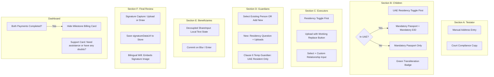

# UAE Will Preparation Platform — Client Feedback & Enhancements Design Spec

**Date:** 2026-10-16  
**Status:** Approved by Client / Ready for Implementation Plan  
**Reference Document:** `docs/client-specs/Fix/Online will fixes.pdf` (and `Online will fixes.docx`)  
**Scope:** OWA Wizard (`components/owa-wizard/`), Dashboard (`app/dashboard/`), and Court Will Generator (`components/court/ADJDBilingualWillDocument.tsx`)

---

## 1. Overview & Objectives

This specification addresses the 11 targeted fixes and usability improvements identified in the client feedback document (`Online will fixes.pdf`). The platform must maintain strict compliance with Abu Dhabi Judicial Department (ADJD) Non-Muslim Civil Family Court standards while streamlining the user intake, resolving UI typing bottlenecks, ensuring document verification flow consistency, and embedding the testator's authentic signature into the generated court document.

---

## 2. Detailed Technical Specifications

### Feature 1: Dashboard Post-Payment State & Support Copy
* **Files:** `app/dashboard/page.tsx`
* **Issue:** 
  1. The "Two-Stage Milestone Billing" card remains visible even after both Stage 1 (Preparation) and Stage 2 (Court Registry) payments are settled and verified.
  2. The support card title is `"Need Legal Help?"` instead of the client's requested friendly inquiry.
* **Specification:**
  1. Evaluate payment completeness: When `will.courtPaymentVerified` (or both Stage 1 and Stage 2 are marked as paid), hide the `Two-Stage Milestone Billing` card entirely.
  2. In place of the billing card when payments are finished, render an active court filing badge: `ADJD Civil Court Filing In Progress` with filing status, application reference ID, and next attestation appointment steps.
  3. Update the dark Navy direct support card:
     * Header: `"Need assistance or have any doubts?"`
     * Subtitle: `"Have questions about consular passport documentation, court video attestations, or need guidance on your will? Reach our team directly."`
     * Button: `"Open In-App Support Ticket →"` linking to `/dashboard/support`.

---

### Feature 2: Testator Residential Address Manual Entry (Section A)
* **Files:** `components/owa-wizard/SectionA_Details.tsx`
* **Issue:** Address had automatic OCR extraction/prefill attempts and displayed an `"Autofilled from Document"` badge.
* **Specification:**
  1. Remove any autofill override on `residentialAddress` from document OCR.
  2. Ensure the input initializes with an empty string (no default mock address prefill).
  3. Remove the `"Autofilled from Document"` pill for address.
  4. Testator must type their current UAE residential address manually.

---

### Feature 3: Section A Document Upload Compliance Copy
* **Files:** `components/owa-wizard/SectionA_Details.tsx`
* **Issue:** The upload header did not explicitly highlight ADJD court compliance purposes.
* **Specification:**
  1. Update Step 1 header and subtitle:
     * Title: `Step 1 · Upload Documents to Autofill Details`
     * Badge: `Court Compliance`
     * Subtitle: `Upload your Passport and Emirates ID to populate fields automatically and satisfy ADJD Civil Family Court statutory requirements.`

---

### Feature 4: Section B Children UAE Residency Order & Mandatory EID
* **Files:** `components/owa-wizard/SectionB_Children.tsx`, `store/useOwaStore.ts`
* **Issue:** 
  1. The question *"Does this child also reside in the United Arab Emirates?"* was placed at the bottom below document uploads and fields.
  2. Emirates ID was marked optional for UAE resident children.
  3. Arabic transliteration did not have a clear green verification state.
  4. Obsolete passport assistance banner created clutter.
* **Specification:**
  1. **Reorder Layout:** In each child card, the question *"Does this child also reside in the United Arab Emirates?"* (`[Yes, In UAE]` / `[No, Outside UAE]`) must appear at the **very top** before any document upload or form field.
  2. **Mandatory Emirates ID if UAE Resident:**
     * If `isUaeResident === true`:
       * Passport: **Mandatory** (`Upload Child Passport`).
       * Emirates ID: **Mandatory** (`Upload Child Emirates ID`).
       * Extract information (Full Name, EID Number, DOB) directly from both documents using Gemini Vision / OCR pipeline.
     * If `isUaeResident === false`:
       * Passport: **Mandatory**.
       * Emirates ID: Completely hidden.
  3. **Visual Feedback for Transliteration:**
     * When `arabicName` is populated (via auto-transliteration or manual editing), display an emerald green status badge:
       `<span className="text-[10px] bg-emerald-50 text-emerald-700 border border-emerald-200 px-2 py-0.5 rounded font-mono font-semibold">✓ Auto-Transliterated</span>`
  4. **Remove Passport Assistance Banner:**
     * Delete the blue callout banner: *"Child does not have a passport yet? ADJD Civil Family Court requires..."*.

---

### Feature 5: Section C Executors Residency, Upload, Working Replace & Typing
* **Files:** `components/owa-wizard/SectionC_Executors.tsx`, `store/useOwaStore.ts`
* **Issue:**
  1. Executors did not ask UAE residency upfront before document upload.
  2. The `Replace` document button was a dummy HTML element without file picker or handler.
  3. Typing `Relationship to Testator` had uncontrolled input glitches.
* **Specification:**
  1. **Residency Question Upfront:** For each executor slot, place the toggle:
     `Does this executor reside in the United Arab Emirates?` `[Yes, In UAE]` `[No, Outside UAE]`
  2. **Document Upload & Replace Functionality:**
     * Render document upload cards below the residency toggle:
       * If UAE Resident: Passport + Emirates ID uploads.
       * If Overseas: Passport upload.
     * Provide a fully working `Replace` button hooked to a hidden `<input type="file" />` that triggers file upload, updates the person document store, and re-runs OCR extraction.
  3. **Relationship to Testator Input:**
     * Replace bare input with a dual control:
       * Dropdown with common legal relationships: `Spouse`, `Brother`, `Sister`, `Parent`, `Adult Child`, `Trusted Friend`, `Professional Trustee`, `Other`.
       * If `Other` is selected, display a responsive text input for custom entry.
       * Maintain controlled state with stable keys to prevent any typing lag or reset.

---

### Feature 6: Section D Guardians Intake for New Nominees
* **Files:** `components/owa-wizard/SectionD_Guardians.tsx`, `store/useOwaStore.ts`
* **Issue:** When adding a new guardian not already in the system, there was no upfront residency question and no document upload.
* **Specification:**
  1. **Existing Person Linking:** If selecting an existing person (such as surviving spouse or relative already in repository), link the record directly.
  2. **New Guardian Intake:** When clicking `+ Add New Guardian`:
     * For **Permanent Guardian (Clause 5)** & **Substitute Permanent Guardian (Clause 5)**:
       * Ask: `Does this guardian reside in the United Arab Emirates?` `[Yes, In UAE]` `[No, Outside UAE]`
       * If Yes: Require Passport + Emirates ID uploads.
       * If No: Require Passport upload.
     * For **Temporary Guardian (Clause 6)**:
       * By court statute, temporary guardians *must* reside in the UAE. Show notice: `UAE Resident (Statutory Requirement under Section 6)` with Passport + Emirates ID uploads.
     * Derived Info: Extract full name, DOB, nationality, and phonetic Arabic transliteration from the uploaded documents.

---

### Feature 7: Section E Beneficiaries Share Percentage Typing Bug
* **Files:** `components/owa-wizard/SectionE_Beneficiaries.tsx`
* **Issue:** `ShareInput` pushed updates to the parent Zustand store on every single keystroke, causing instant re-rendering of all beneficiary cards, cursor snapping, and preventing smooth typing or backspacing (e.g. typing `50` or changing `100`).
* **Specification:**
  1. Refactor `ShareInput` to maintain internal string state `text` initialized from `value`.
  2. While the user is typing, only update `text`. Do not fire store commits on intermediate or empty keystrokes.
  3. On `onBlur`, or when `Enter` is pressed:
     * Parse the string to a valid float between `0` and `100`.
     * Update `text` to formatted value.
     * Commit the verified number to the Zustand store via `onChange(parsed)`.
  4. Add an optional debounce (400ms) for store updates if blur doesn't fire, ensuring smooth, instant local keystrokes.

---

### Feature 8: Section F Testator Signature & Court Document Placement
* **Files:** 
  * `components/owa-wizard/SectionF_ReviewDraft.tsx`
  * `components/court/ADJDBilingualWillDocument.tsx`
  * `store/useOwaStore.ts`
  * `types/owa.ts`
* **Issue:** The court document only showed a placeholder line `(Signed at ADJD Court)` with no facility for the testator to upload or draw their authentic signature.
* **Specification:**
  1. **Schema Update:** Add `signatureDataUrl?: string` to `OwaPerson` and `testatorPerson` in store and database persistence.
  2. **Signature Intake Card in Section F:**
     * Positioned directly above the final confirmation checkbox.
     * Two user-friendly tabs:
       * **Upload Signature:** File input accepting JPG/PNG/SVG/WebP. Validates and converts to clean base64 data URL.
       * **Draw Signature:** HTML5 Canvas drawing pad with touch and mouse support, stroke smoothing, `Clear Canvas`, and `Save Signature` buttons.
     * Preview card showing the captured signature with `Remove / Redo Signature` option.
  3. **Court Document Embedding:**
     * In `components/court/ADJDBilingualWillDocument.tsx` under the `SIGNATURE / التوقيع` section:
       * When `testator.signatureDataUrl` is present:
         Render the signature image directly above the court signature line:
         ```tsx
         <div className="mt-2 flex flex-col items-start">
           
           <div className="border-b border-gray-400 w-56 text-[10px] text-gray-500 font-mono">
             Digitally Verified Signature · ADJD Court Form
           </div>
         </div>
         ```
       * If no signature is provided yet:
         Render the fallback placeholder line: `(Signed at ADJD Court)`.

---

## 3. Data Flow & State Management



---

## 4. Testing & Verification Plan

1. **Dashboard:**
   * Test with `will` where `paid = true` and `courtPaymentVerified = true` $\rightarrow$ verify billing card is hidden.
   * Verify support card title reads "Need assistance or have any doubts?".
2. **Section A:**
   * Verify address input starts empty and is not overwritten by proof of address OCR.
3. **Section B:**
   * Verify Residency question appears at the top.
   * Toggle `In UAE` $\rightarrow$ verify EID is marked mandatory and upload is required.
   * Toggle `Outside UAE` $\rightarrow$ verify EID is hidden.
   * Verify green transliteration pill appears when Arabic name is present.
   * Verify passport assistance callout is completely gone.
4. **Section C:**
   * Verify residency question appears first.
   * Click `Replace` button $\rightarrow$ verify system file picker opens and replaces attached document.
   * Type in relationship field $\rightarrow$ verify zero input lag.
5. **Section D:**
   * Add new permanent guardian $\rightarrow$ verify residency question and document upload cards appear.
6. **Section E:**
   * Test typing `"50"` or backspacing in `Share Percentage` $\rightarrow$ verify seamless typing without cursor jumps.
7. **Section F & Document:**
   * Upload signature image or draw signature $\rightarrow$ verify preview updates immediately.
   * Inspect dual-column bilingual will preview $\rightarrow$ verify signature image renders above `SIGNATURE / التوقيع`.
